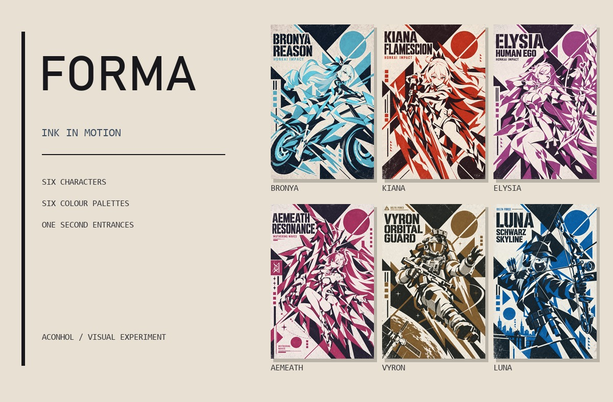

# FORMA · INK IN MOTION

六名角色、六套主题色、一秒完成的墨版与装备独立入场。使用 WebGL2 合成原稿图层，海报全程保持 1024×1536；整页配色随角色平滑切换。

[在线体验](https://demo.aconhol.xyz/projects/forma/) · [下载独立 HTML](https://github.com/AconHol/forma-ink-motion/releases/latest) · [作品集](https://demo.aconhol.xyz/#works)



## 运行

需要 Node.js，无 npm 运行时依赖。

```sh
npm run dev
```

打开 http://127.0.0.1:4173/ 。若端口被占用，可通过 PORT 环境变量指定其他端口。仓库内已提供可直接运行的静态文件与全部素材。

## 动画与交互

- BRONYA：摩托整体滑入，补全骑手遮住的车身，腿与靴子留在人物前景。
- KIANA：人物、剑身、火焰三组独立时序；剑身围绕握点收稳，火焰沿剑锋展开，双手跟随人物。
- ELYSIA / LUNA：弓与箭分别入位，保留弓弦和手部遮挡。
- AEMEATH：机兵整体浮升收势。
- VYRON：步枪与头顶三目夜视仪错峰入场。

点击角色或使用左右方向键切换，空格暂停/继续，R 重播。支持拖动时间线、半速、柔和动效、全屏和保存分层 SVG。

主界面适配可见视口，禁用文字选中与页面滚动；横屏和矮窗口会调整控件排布。点击右上角「自动演示」后，按当前顺序轮播六张海报，每张入场后停留约 4 秒；暂停、拖动时间线、打开说明或页面进入后台会暂停自动切换。自动演示默认关闭。

全部 42 个素材先加载、解码为驻留位图并上传纹理，完成后才开始入场；角色切换不再请求素材。动画落定后停止请求动画帧，页面进入后台时暂停时钟。GPU 不可用或上下文丢失时回退完整 Canvas2D 画面。

## 修改与构建

只修改页面或动画代码时，可直接刷新预览。重建素材需要 Python、NumPy 与 Pillow：

```sh
python -m pip install -r tools/requirements-print-v6.txt
npm run build
npm run check
npm run standalone
```

`build` 从已定稿的无损原图和蒙版重建图层，再输出无损 WebP；不需要下载分割模型。`standalone` 在仓库根目录生成 FORMA-standalone.html，内含图像、字体、样式和脚本，可离线打开。

```text
dist/                       静态网页与无损 WebP 图层
  print-app.js              交互、播放时钟、预加载和主题色
  print-motion.js           非线性曲线、墨浪和装备姿态
  ink-renderer.js           原生分辨率 GPU 合成与换色
source/approved/            六张定稿无损 WebP
source/equipment-v7/        独立图层蒙版、时序与摩托补绘
tools/                      构建、检查、独立 HTML 打包与预览
qa/                         像素归属、视觉对照与性能摘要
```

网页导出的分层 SVG 包含原稿透明位图，用于保留纸纹，属于位图图层容器。终态通过六张原图逐像素校验；动画中间帧与 Canvas2D 参考对照的差异主要来自边缘抗锯齿和混色舍入，没有省略画面元素或调整原有编排。

## 验证

`npm run check` 检查素材哈希、时序、非线性曲线及终态姿态。浏览器验证包含六张终态原生 RGB、36 个时间点的渲染对照、预加载后的离线切换、手机字体与 GPU 回退。

本机 Windows Edge / RTX 3060、390×844 手机视口、4 倍 CPU 降速的受控对照中，帧间隔 95 分位从约 67 ms 降至 16 ms。该结果是本机对照，不是手机真机测量；摘要见 qa/performance-summary.json。

## 许可

代码采用 [MIT License](LICENSE)。字体、参考代码与角色美术的归属见 [NOTICE.md](NOTICE.md)。
